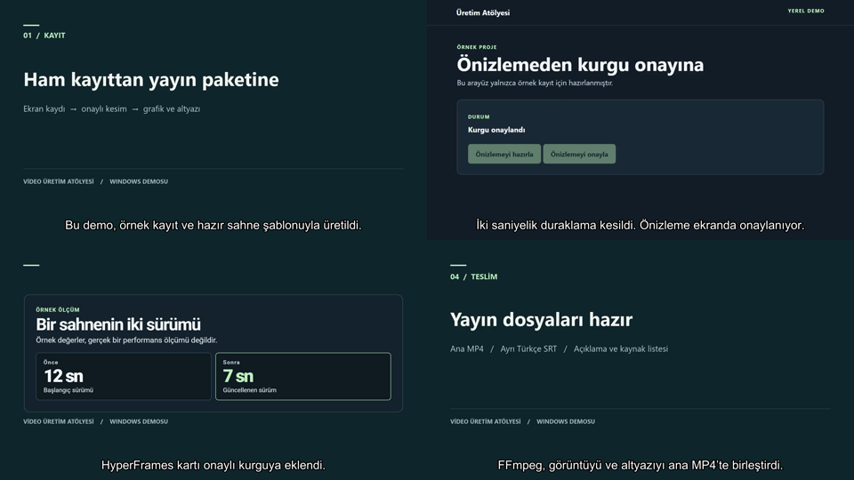

# Video Üretim Atölyesi

Windows ve Türkçe ekran anlatımları için yerel video üretim başlangıç kiti. Bir kaydı zaman kodlu transkripte, onaylı kesime, önizlemeye ve yüklemeye hazır bir dosya paketine dönüştürür. **Kaynak kayıt, aday plan ve final kurgu ayrı dosyalarda saklanır.**

Çekirdek Python ve FFmpeg ile çalışır. Cap veya Playwright giriş medyasını sağlar. Codex ya da Claude Code plan önerebilir. HyperFrames şablonları grafikleri üretir. Topview, Obsidian ve YouTube gibi servisler [isteğe bağlı entegrasyonlar](docs/entegrasyonlar.md) olarak belgelenir.

## İzlenebilir demo

[18 saniyelik MP4 demoyu izle veya indir](https://github.com/Mert-Oezdemir/video-uretim-atolyesi/releases/download/v0.1.0/video-uretim-atolyesi-demo.mp4) · [Türkçe SRT](https://github.com/Mert-Oezdemir/video-uretim-atolyesi/releases/download/v0.1.0/video-uretim-atolyesi-demo.srt)



Örnek tarayıcı kaydından iki saniyelik duraklama çıkarılır. HyperFrames kartı ve Türkçe altyazı eklenerek 1280 × 720, 30 fps MP4 üretilir. Demo sessizdir. Karşılaştırma kartındaki değerler örnektir.

## İlk deneme

Python 3.10 veya üzeri ve `PATH` üzerinde `ffmpeg` ile `ffprobe` gerekir. FFmpeg dağıtımında `libx264` veya `libopenh264` kodlayıcısı olmalı. Kurulumdan sonra yeni bir PowerShell aç. [Python](https://www.python.org/downloads/windows/) · [FFmpeg Windows indirme bağlantıları](https://ffmpeg.org/download.html#build-windows)

Depoyu Git ile indir ve demoyu çalıştır.

```powershell
git clone https://github.com/Mert-Oezdemir/video-uretim-atolyesi.git
cd video-uretim-atolyesi
python -m atolye doctor
python -m atolye demo jobs/demo
```

Demo yerel olarak sentetik görüntü, test tonu ve örnek altyazı üretir. FFmpeg ile kesim, grafik katmanı, önizleme ve ana MP4 oluşturur. Yayın dosyalarını `jobs/demo/outputs/publish/` altında bulabilirsin. Demo için gerçek kayıt, konuşma modeli, Node.js veya API anahtarı gerekmez. Tekrar çalıştırırken henüz oluşturulmamış bir klasör adı seç.

## Tek komutla üretim

Kesim planını inceledikten sonra `python -m atolye run jobs/ilk-video --plan cut/cuts.json --model small --burn-in` komutu kesimi uygular, yerel Whisper ile son altyazıyı üretir ve önizlemeyi hazırlar. Kaydın tamamını korumak için `--plan` yerine `--keep-all` kullan. Sessizlik kesmek için `--auto`, onaylanmış grafik planı için `--overlays graphics/overlays.json` ekle.

Önizlemeyi inceledikten sonra aynı komuta `--final` ekleyerek ana MP4 ve yayın paketini üret. Yeni teslim için `--package-name publish-v2` seç. `--language` hem transkripti hem paketlenen ana altyazının dil etiketini belirler. Ajan planı için önce ham transkripti üretip `plan --engine codex` veya `plan --engine claude` kullanabilirsin. Aday kesimi izleyip onayladıktan sonra `--plan plans/cut.candidate.json` ile uygula.

## Kendi videon

### 1. Kayıt ve ham transkript

Bir iş klasörü oluştur. Cap Studio'dan çıkardığın MP4'ü iş klasöründe `raw/input.mp4` olarak sakla. Kayıtta hem görüntü hem de ses izi olsun.

```powershell
python -m atolye init jobs/ilk-video
```

Sadece ses kaydettiysen `raw/voice.wav` dosyasını iş klasörüne koy. `python -m atolye prepare jobs/ilk-video --audio raw/voice.wav --aspect 9:16` komutu anlatım süresinde bir dikey görüntü tabanı oluşturur. Yatay taban için `--aspect 16:9` kullan. Playwright gibi sessiz bir ekran kaydını eklemek için `--video raw/browser/demo.webm` ver. Anlatım sıfırıncı saniyede başlar. Görüntü daha kısa kalırsa son karesi uzatılır. Ardından grafikleri ayrı katmanlar olarak ekleyebilirsin.

Whisper için ayrı bir Python ortamı kullanabilirsin. Gerçek transkript komutu bu ortamda çalıştırılmalı. İlk kullanımda model indirilir. Uyumlu PyTorch kurulumu için [Whisper belgelerine](https://github.com/openai/whisper#setup) bak. Python 3.10 ve üzerindeki güncel pip, sistem sertifika deposunu da kullanır.

```powershell
python -m venv .venv
.\.venv\Scripts\python.exe -m pip install --upgrade pip
.\.venv\Scripts\python.exe -m pip install openai-whisper
.\.venv\Scripts\python.exe -m atolye transcribe jobs/ilk-video --input raw/input.mp4 --name raw --language tr --model base
```

`transcript/raw.json` ve `transcript/raw.srt` ham kaydın zamanını kullanır. Ajanla çalışacaksan `jobs/ilk-video/brief.md` içinde videonun hedefini ve korunması gereken aralıkları yaz.

### 2. Kesimi seç ve onayla

```powershell
python -m atolye plan jobs/ilk-video --stage cut
```

`plans/cut.prompt.md` dosyasını seçtiğin ajana ver. CLI üzerinden plan almak için ilgili CLI'yı kurup hesabında oturum aç. Sonra `--engine codex` veya `--engine claude` ekleyebilirsin. Bu seçenekte brief, transkript ve varsa kaynak listesi seçilen ajanla işlenir. Ajan çıktısı `plans/cut.candidate.json` olur ve senin incelemeni bekler. [Codex CLI](https://developers.openai.com/codex/cli) · [Claude Code kurulumu](https://code.claude.com/docs/en/setup)

Korunacak aralıkları `cut/cuts.json` dosyasına yaz. Aşağıdaki örnek kaynak videonun ilk üç saniyesini tutar. Aralıkları kaynak saniyesiyle, sıralı ve çakışmasız belirt.

```json
{"keep": [{"start": 0, "end": 3}]}
```

```powershell
python -m atolye cut jobs/ilk-video --input raw/input.mp4 --plan cut/cuts.json
.\.venv\Scripts\python.exe -m atolye transcribe jobs/ilk-video --input cut/locked.mp4 --name final --language tr --model base
```

Önceden kurgulanmış bir kayıtta `cut` komutunu `--plan` olmadan çalıştırarak kesimi koruyabilirsin. İsteğe bağlı `--auto`, [Auto-Editor](https://auto-editor.com/installing) ile sessizlikleri keser. `--plan` ve `--auto` birlikte verilirse önce plan uygulanır. Özellikle ekran demosunda işlemlerin sessiz ama gerekli bölümlerini önizlemede kontrol et.

### 3. Grafik, önizleme ve final

`python -m atolye plan jobs/ilk-video --stage storyboard`, onaylı kesimden üretilen `transcript/final.json` ile sahne planı istemi hazırlar. `--engine` ile üretilen aday `plans/storyboard.candidate.json` içinde kalır. Planı gözden geçir ve gereken sahneleri [HyperFrames şablonlarıyla](graphics/README.md) hazırla. Şablonlar için Node.js ve HyperFrames ayrıca gerekir.

Render edilmiş klipleri iş klasörüne koy. Onaylı kesime göre başlama zamanı ve süreleri `graphics/overlays.json` içine yaz. Bu örnek, `kart.mov` dosyasını birinci saniyede başlatır ve iki saniye boyunca gösterir.

```json
{"overlays": [{"path": "graphics/kart.mov", "start": 1, "duration": 2}]}
```

```powershell
python -m atolye render jobs/ilk-video --input cut/locked.mp4 --overlays graphics/overlays.json --captions transcript/final.srt --preview
```

`outputs/preview.mp4` dosyasında kesimi, ses senkronunu, sansürü, grafikleri ve okunurluğu kontrol et. Ayrı SRT'yi oynatıcıya ekleyebilir ya da hem önizlemede hem finalde `--burn-in` ile görüntüye yazdırabilirsin. `--burn-in` FFmpeg'in `subtitles` filtresini gerektirir. Grafik kullanmıyorsan `--overlays` seçeneğini kaldır. Kesim değiştiyse altyazıyı ve grafik zamanlarını yeniden hizala.

```powershell
python -m atolye render jobs/ilk-video --input cut/locked.mp4 --overlays graphics/overlays.json --captions transcript/final.srt
python -m atolye verify jobs/ilk-video --input outputs/master.mp4 --captions outputs/master.srt
```

### 4. Yayın dosyalarını hazırla

İstersen iş klasörüne `publish.json` ekle. `title`, `description` ve isteğe bağlı `chapters` alanlarını kullan. Bölüm satırları `start` ve `title` alanlarını alır. Bölüm kullanırsan ilk `start` değeri `0` olmalı ve en az üç bölüm bulunmalı. Her bölüm en az 10 saniye sürmeli. `start` tam sayı olarak son kurgunun saniyesidir. [YouTube bölümleri](https://support.google.com/youtube/answer/9884579?hl=tr)

```json
{"title": "İlk ekran anlatımım", "description": "Kısa bir uygulama demosu", "chapters": []}
```

İsteğe bağlı `sources.json`, açıklamaya eklenecek kaynakları tutar.

```json
{"sources": [{"id": "ffmpeg", "title": "FFmpeg belgeleri", "url": "https://ffmpeg.org/documentation.html"}]}
```

```powershell
python -m atolye package jobs/ilk-video
```

`outputs/publish/` altında ana MP4, başlık, açıklama, kaynak listesi ve doğrulama raporu oluşur. Final render'da `--captions` ile üretilen `outputs/master.srt`, `captions.tr.srt` adıyla eklenir. İngilizce altyazı ve kapak eklemek için iş klasörüne `transcript/final.en.srt` ve `assets/thumbnail.png` koy. Yeni bir paket sürümü için `--name publish-v2` kullan. YouTube Studio'ya yüklemeden önce dosyaları gözden geçir.

Ana altyazı Türkçe dışında bir dildeyse `publish.json` içine `"language": "en"` gibi bir dil etiketi ekle. Bu etiket, paketlenen SRT dosyasının adına yansır.

## Test

Windows'ta yerel üretim ve iki ajan bağlantısının gerçek çalıştırma sonuçları [doğrulama kaydında](docs/dogrulama.md) bulunur. Türkçe konuşma Whisper small ile, kesim ve sahne planları Codex ve Claude Code ile doğrulandı.

`python -m unittest discover -s tests -v` komutu sentetik kayıt, dikey anlatım tabanı, altyazı doğrulaması ve yayın paketini sınar. Auto-Editor PATH üzerinde varsa sessizlik kesimi testi de çalışır.

## Dosyalar ve araçlar

- **İş klasörü.** `raw/` kayıtlar, `transcript/` ham ve son zaman kodları, `cut/` onaylı kurgu, `plans/` aday planlar, `assets/` medya, `graphics/` grafikler, `outputs/` render ve yayın paketi. CLI seçeneklerindeki `--input`, `--captions`, `--plan` ve `--overlays` yolları iş klasörüne göredir.
- **İş akışları.** [Dört HyperFrames şablonu](graphics/README.md) · [Playwright tarayıcı demosu](demo-browser/README.md) · [Topview, MLX, video-use, ses ve yayın entegrasyonları](docs/entegrasyonlar.md)
- **Yerel ve hesap gerektiren adımlar.** Sentetik demo, kesim, render ve doğrulama yerelde çalışır. Whisper modeli ilk kullanımda indirilir. İsteğe bağlı ajan komutları ile Topview ve yayın akışı, seçtiğin hesabın oturumuna ve erişimine bağlıdır. Medyayı buluta taşıyan adımları kendi onayınla başlat.

## Kaynaklar

Üretim yaklaşımı için [Avenox Studio](https://github.com/avenoxai/avenoxskills/tree/main/avenox-studio), onaylı kesim ve pano akışı için [Sirio Berati](https://github.com/sirioberati/YouTube-AI-Video-Editing-System) ve ayrı kurgu seçeneği için [video-use](https://github.com/browser-use/video-use) incelendi. Paket kendi örneklerini ve kodunu içerir.
